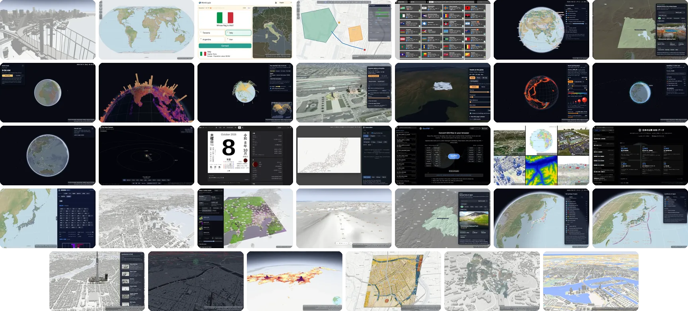
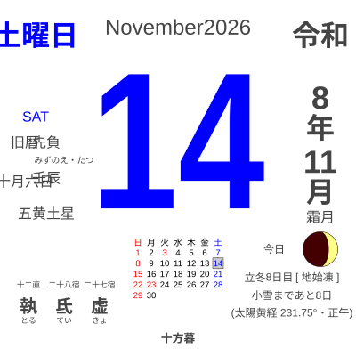

  <a href="https://www.ortho-earth.com/"><picture>
    <source media="(prefers-color-scheme: dark)" srcset="brand/wordmark-fff.svg">
    
  </picture></a> 
  <picture>
    <source media="(prefers-color-scheme: dark)" srcset="brand/formula-fff.svg">
    
  </picture>

  A 3D globe map engine that runs entirely in your browser. 
  WebGPU · no server, no account.

  <a href="https://www.ortho-earth.com/"><b>www.ortho-earth.com</b></a>

 

### The Ortho Earth family

- **[ortho-earth](https://github.com/kenjiyoshidahome2026-bit/ortho-earth)** — 3D globe map engine. WebGPU, MapLibre GL JS compatible API, 3D Tiles, terrain at true scale. Starts with about 380 KB.
- **[geopbf](https://github.com/kenjiyoshidahome2026-bit/geopbf)** — carry geometry as geometry. Compact binary for features + GPU-readable topology.
- **[gint](https://github.com/kenjiyoshidahome2026-bit/gint)** — 64-bit geospatial primitive for fast rendering.
- **[altpbf](https://github.com/kenjiyoshidahome2026-bit/altpbf)** — the planet's elevation in 8 tiles / 55 MB.
- **[geoedit](https://github.com/kenjiyoshidahome2026-bit/geoedit)** — topological editor, edits on the sphere.
- **[ortho-world](https://github.com/kenjiyoshidahome2026-bit/ortho-world)** — 262 countries in 26 languages, drop into a `
`.
- **[himekuri](https://github.com/kenjiyoshidahome2026-bit/himekuri)** — the calendar on the right. Lunisolar date, rokuyō, 72 pentads. It tears off one page every midnight (JST).
- **[plateau-bench](https://github.com/kenjiyoshidahome2026-bit/plateau-bench)** — PLATEAU 3D Tiles rendering benchmark, raw results open.
