<h1 align="center">
  <a href="https://www.ortho-earth.com/"><picture>
    <source media="(prefers-color-scheme: dark)" srcset="brand/logo-fff.svg">
    
  </picture></a> 
  Ortho Earth
</h1>

  <b>maplibre + cesium − mercator = ortho-earth</b> 
  I build <b>Ortho Earth</b> — a 3D globe map engine that runs entirely in your browser. 
  WebGPU · MapLibre GL JS compatible · 3D Tiles · terrain at true scale · no server, no account.

  <a href="https://www.ortho-earth.com/">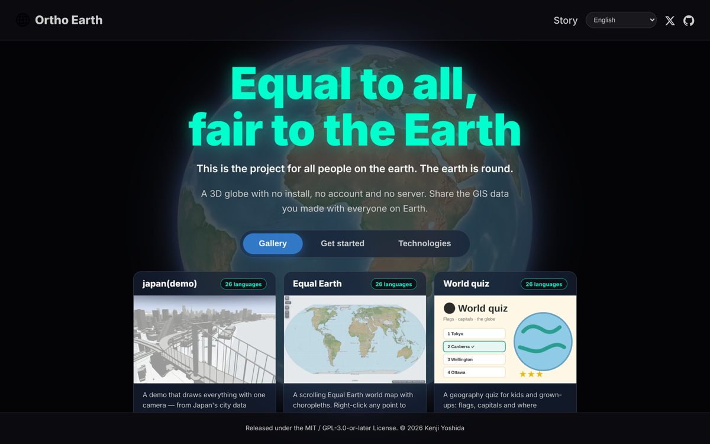</a>

  <a href="https://www.ortho-earth.com/"><b>www.ortho-earth.com</b></a> ·
  <a href="https://github.com/kenjiyoshidahome2026-bit/ortho-earth">Source on GitHub</a> ·
  <a href="https://www.ortho-earth.com/docs/introduction">Docs</a> ·
  <a href="https://www.ortho-earth.com/maplibre/">MapLibre examples</a>

### Built with Ortho Earth

Live demos — click to open. Everything runs in your browser.

<table>
<tr>
<td width="33%" valign="top"><a href="https://www.ortho-earth.com/globe/hex">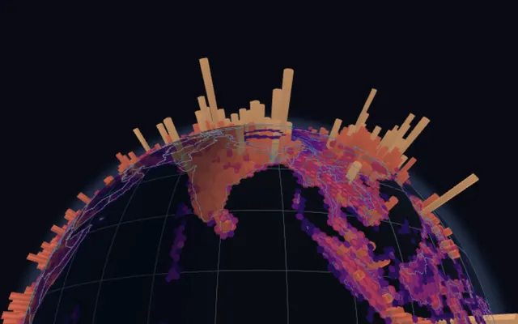</a> <b><a href="https://www.ortho-earth.com/globe/hex">World population in hexagons</a></b></td>
<td width="33%" valign="top"><a href="https://www.ortho-earth.com/globe/quakes/">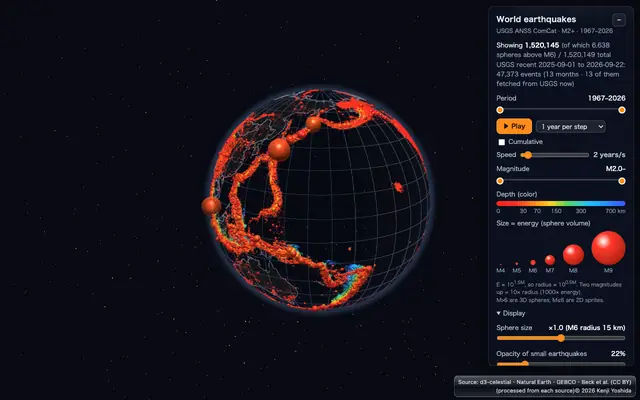</a> <b><a href="https://www.ortho-earth.com/globe/quakes/">World earthquakes</a></b></td>
<td width="33%" valign="top"><a href="https://www.ortho-earth.com/globe/arcs">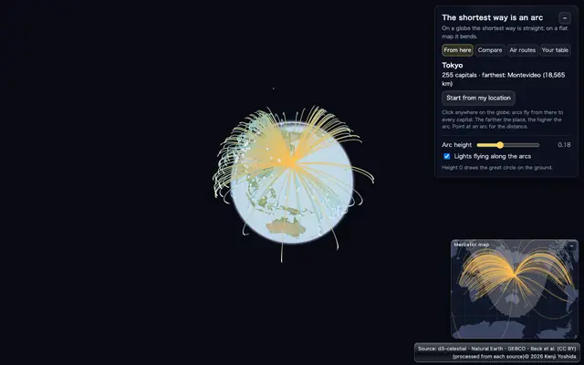</a> <b><a href="https://www.ortho-earth.com/globe/arcs">The shortest way is an arc</a></b></td>
</tr>
<tr>
<td width="33%" valign="top"><a href="https://www.ortho-earth.com/japan/models">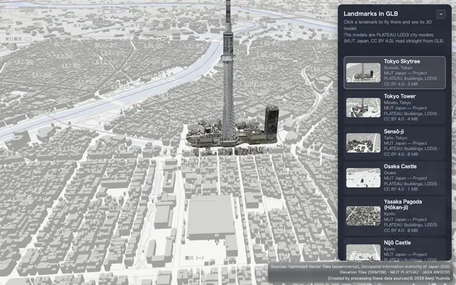</a> <b><a href="https://www.ortho-earth.com/japan/models">Tokyo in 3D</a></b></td>
<td width="33%" valign="top"><a href="https://www.ortho-earth.com/nl/">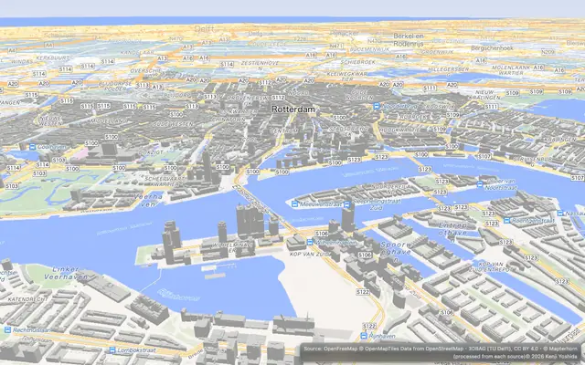</a> <b><a href="https://www.ortho-earth.com/nl/">The Netherlands in 3D</a></b></td>
<td width="33%" valign="top"><a href="https://www.ortho-earth.com/globe/splat">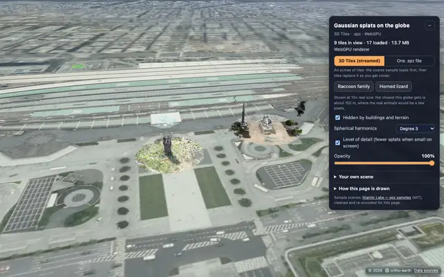</a> <b><a href="https://www.ortho-earth.com/globe/splat">Gaussian splats</a></b></td>
</tr>
<tr>
<td width="33%" valign="top"><a href="https://www.ortho-earth.com/japan/?g=showcase/pop-density-2020.geopbf#7.6/35.3/139.1/62t/-25r">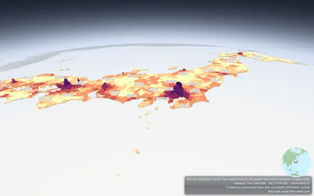</a> <b><a href="https://www.ortho-earth.com/japan/?g=showcase/pop-density-2020.geopbf#7.6/35.3/139.1/62t/-25r">Statistics in 3D</a></b></td>
<td width="33%" valign="top"><a href="https://www.ortho-earth.com/japan/?iiif=/japan/showcase/edo-nihonbashi-1850.iiif.json#15.7/35.6895/139.778">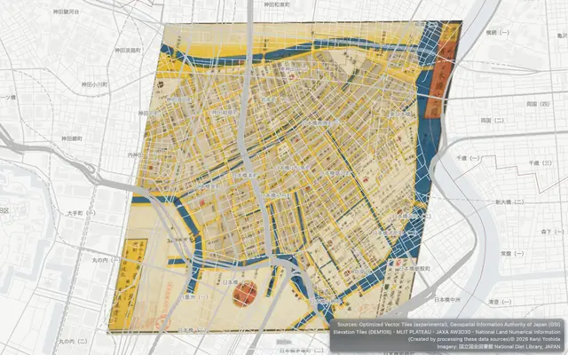</a> <b><a href="https://www.ortho-earth.com/japan/?iiif=/japan/showcase/edo-nihonbashi-1850.iiif.json#15.7/35.6895/139.778">Edo, 1850</a></b></td>
<td width="33%" valign="top"><a href="https://www.ortho-earth.com/japan/tellus">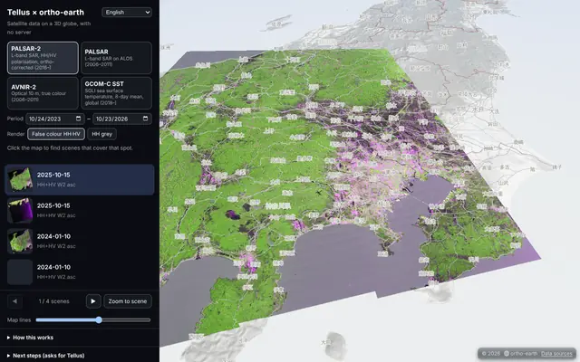</a> <b><a href="https://www.ortho-earth.com/japan/tellus">Satellite images (COG)</a></b></td>
</tr>
<tr>
<td width="33%" valign="top"><a href="https://www.ortho-earth.com/globe/physical">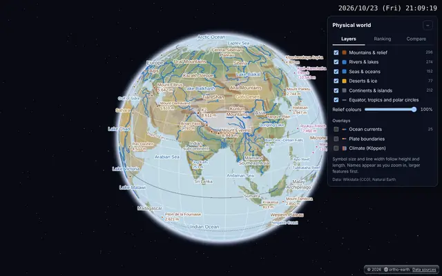</a> <b><a href="https://www.ortho-earth.com/globe/physical">Landforms of the World</a></b></td>
<td width="33%" valign="top"><a href="https://www.ortho-earth.com/quiz/">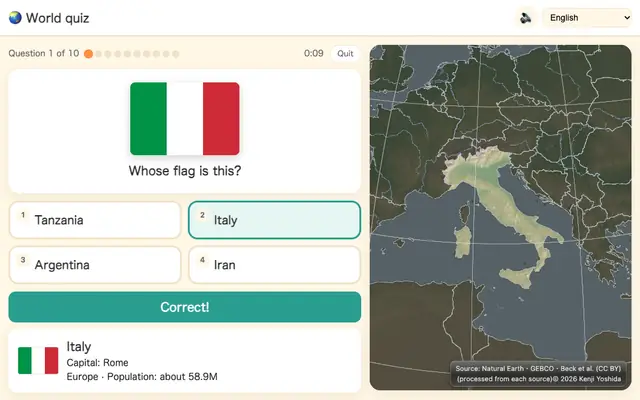</a> <b><a href="https://www.ortho-earth.com/quiz/">World quiz</a></b></td>
<td width="33%" valign="top"><a href="https://www.ortho-earth.com/maplibre/">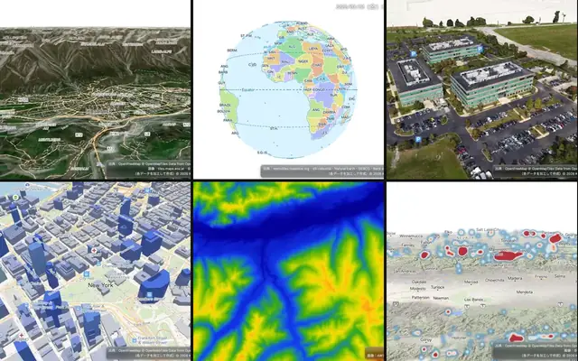</a> <b><a href="https://www.ortho-earth.com/maplibre/">139 MapLibre examples</a></b></td>
</tr>
</table>

<a href="https://www.ortho-earth.com/">34 demos in all →</a>

 

### The Ortho Earth family

- **[ortho-earth](https://github.com/kenjiyoshidahome2026-bit/ortho-earth)** — 3D globe map engine. WebGPU, MapLibre GL JS compatible API, 3D Tiles, terrain at true scale. Starts with about 380 KB.
- **[geopbf](https://github.com/kenjiyoshidahome2026-bit/geopbf)** — carry geometry as geometry. Compact binary for features + GPU-readable topology.
- **[gint](https://github.com/kenjiyoshidahome2026-bit/gint)** — 64-bit geospatial primitive for fast rendering.
- **[altpbf](https://github.com/kenjiyoshidahome2026-bit/altpbf)** — the planet's elevation in 8 tiles / 55 MB.
- **[geoedit](https://github.com/kenjiyoshidahome2026-bit/geoedit)** — topological editor, edits on the sphere.
- **[ortho-world](https://github.com/kenjiyoshidahome2026-bit/ortho-world)** — 262 countries in 26 languages, drop into a `
`.
- **[himekuri](https://github.com/kenjiyoshidahome2026-bit/himekuri)** — the calendar on the right. Lunisolar date, rokuyō, 72 pentads. It tears off one page every midnight (JST).
- **[plateau-bench](https://github.com/kenjiyoshidahome2026-bit/plateau-bench)** — PLATEAU 3D Tiles rendering benchmark, raw results open.
